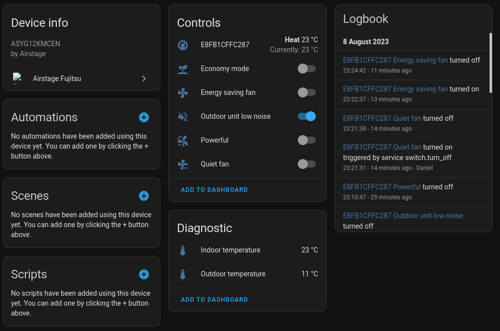
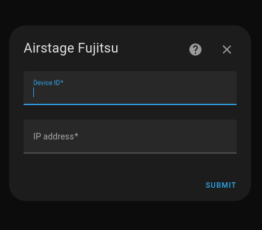

# Fujitsu Airstage Home Assistant component

Connects your Fujitsu Airstage air conditioner to Home Assistant.

## Installation

### HACS Installation

1. Open HACS
2. Select Integrations, then select the 3-dots in the upper-right corner, then select Custom Repositories.
3. Put the Reposity URL in the Repository field, then select Integration in the Category dropdown list and click Add.
4. Now you can search for Airstage in HACS and install it
5. After the installation you need to restart Home Assistent
6. Now you can skip Configuration and proceed with Usage

### Custom components

1. Download or clone the ha_airstage Integration to your local machine.
2. Navigate to the custom_components directory in your Home Assistant installation directory.
3. Copy the folder custom_components/fujitsu_airstage from the downloaded ha_airstage Integration to the Home Assistant custom_components directory.
5. Restart Home Assistant.

## Configuration

After install go to "Add integration" and search after Fujitsu Airstage.

### Control modes

To add a local device you need the IP Address and Device ID. On my device the MAC address was stated so it was easy to find the IP address on my local network.
The device id is the same as the MAC address exept the ":". Or you can scan the wifi SSID and remove the "AP-WH3X-" the device id is the last 12 characters.

## Service monitor and function settings (local mode)

In local mode the integration also reads the adapter's *service monitor* values
and the indoor unit's function settings, when the adapter provides them. They
appear as diagnostic sensors:

| Sensor | Parameter | Notes |
|---|---|---|
| Compressor frequency | `ou_cmp_freq` | Hz (rps); empty while the compressor is off |
| Outdoor unit current | `ou_current` | reported in 1/100 |
| Intake temperature | `iu_suct_tmp` | raw intake thermistor |
| Corrected intake temperature | `iu_indoor_tmp_crct` | after the unit's room temperature correction |
| Indoor heat exchanger temperature | `iu_heat_ex_tmp` | |
| Indoor fan speed | `iu_fan_rot1` | rpm |
| Outdoor heat exchanger / air / discharge temperature | `ou_heat_ex_tmp`, `ou_outdoor_tmp`, `ou_disc_tmp` | |
| 4-way valve | `ou_four_way_vlv` | changes during defrost |
| Expansion valve 1–5 | `ou_exp_vlv1`…`5` | steps; one per indoor unit on multi splits (2–5 disabled by default) |
| Function setting NN | `iu_fld_setNN` | installer settings 11, 30, 31, 35, 36, 40, 42, 44, 46, 48, 49, 60 (disabled by default, read every ~5 min) |

Temperatures are reported in 1/100 °C, `65535` means the unit does not provide
the value. Adapters that do not answer these parameters are detected on the
first update and not polled again.
